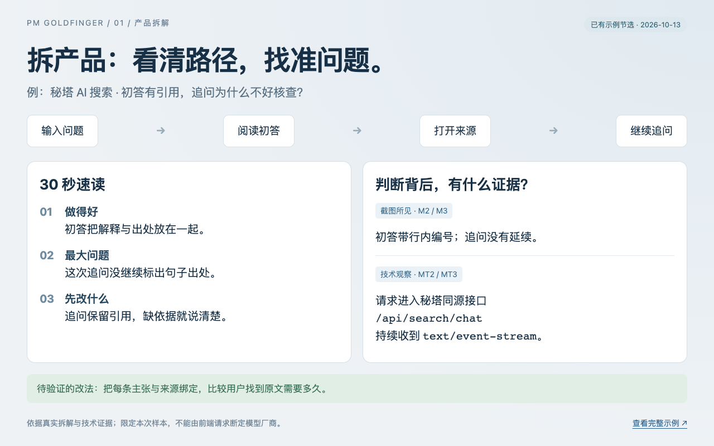
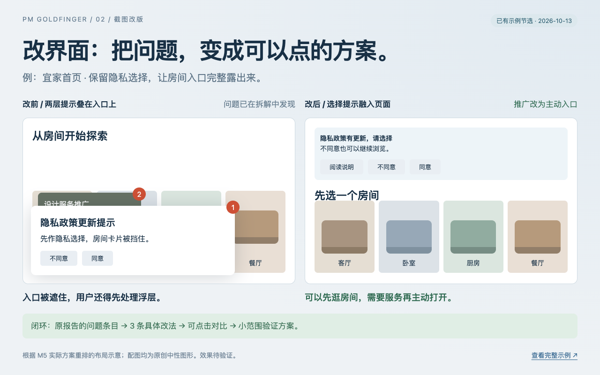
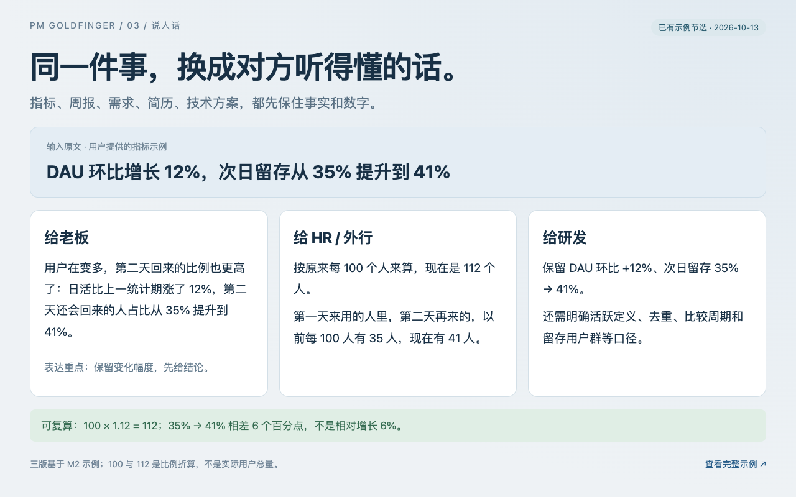
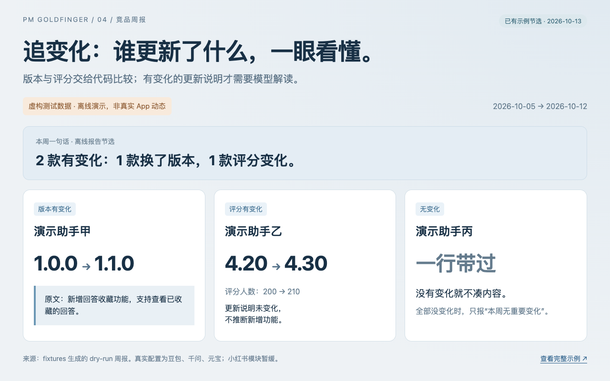

# 产品经理金手指

**给产品经理的 AI 工具箱：拆产品、改界面、说人话、追竞品，把想法变成可核查的成果。**

An AI toolkit for product managers: analyze products, redesign screens, explain clearly, and track competitors.

<table>
<tr>
<td width="50%">
<a href="skills/teardown/examples/02-metaso.md"></a><br>
<strong>① 拆产品</strong> · 看清用户怎么用、卡在哪，也能查看技术证据。<br>
<a href="skills/teardown/examples/02-metaso.md">看秘塔拆解</a> · <a href="skills/teardown/SKILL.md">使用方法</a>
</td>
<td width="50%">
<a href="skills/redesign/examples/index.html"></a><br>
<strong>② 改界面</strong> · 把截图里的体验问题，改成两个可点击原型。<br>
<a href="skills/redesign/examples/index.html">看三组改版</a> · <a href="skills/redesign/SKILL.md">使用方法</a>
</td>
</tr>
<tr>
<td width="50%">
<a href="skills/plain-talk/examples/04-metric.md"></a><br>
<strong>③ 说人话</strong> · 同一段话，老板、HR、研发各有一版，事实不变。<br>
<a href="skills/plain-talk/examples/04-metric.md">看指标改写</a> · <a href="skills/plain-talk/SKILL.md">使用方法</a>
</td>
<td width="50%">
<a href="agents/competitor-weekly/reports/examples/dry-run.md"></a><br>
<strong>④ 追变化</strong> · 比较竞品版本、评分与更新说明，只报变化。<br>
<a href="agents/competitor-weekly/reports/examples/dry-run.md">看离线周报</a> · <a href="agents/competitor-weekly/README.md">配置与运行</a>
</td>
</tr>
</table>

三个 Skill 使用 Codex / Claude Code 的能力；周报是可定时运行的 Python 脚本。当前周报跟踪中国区 App Store，小红书口碑暂缓。

[作品集网页（本地打开）](docs/index.html) · [BOSS 作品集长图](docs/assets/boss-longimage.png) · [手机宽度预览](docs/assets/boss-phone-preview.png)。网页与长图已完成，GitHub 仓库和 Pages 尚未公开；[发布步骤](docs/github-pages.md)待确认后执行。

## 安装：先用三个 Skill

准备 Python 3.11+ 和 Codex 或 Claude Code。将本仓库下载到固定位置，在仓库根目录运行这一条命令：

```sh
bash scripts/install_skills.sh
```

脚本先列出计划，输入 `y` 后安装 `teardown`、`redesign`、`plain-talk`。默认链接到 `~/.agents/skills`（Codex）与 `~/.claude/skills`（Claude Code），不需要模型密钥，也不会安装 rea、浏览器或定时任务。保留仓库目录，避免软链接失效；新安装后重新打开宿主会话，让技能列表刷新。

只装一个宿主、预览或卸载：

```sh
bash scripts/install_skills.sh --target codex
bash scripts/install_skills.sh --target claude --dry-run
bash scripts/install_skills.sh --uninstall
```

重复安装会跳过已存在的本项目链接；同名外部文件不会被覆盖；卸载保留仓库与其他技能。已在 macOS 的全新 Python 虚拟环境和空技能目录验证，不依赖第三方 Python 包；其他系统与宿主的完整运行兼容性尚未实测。[安装与验收记录](docs/m6-validation.md)

## 四个工具怎么用

### ① 产品拆解：知道哪里卡，也说得清凭什么

给产品名、公开网址或截图，输出“30 秒速读”、功能地图、用户路径、商业模式和 3 个具体 AI 机会点。提供目标岗位时，另给面试准备方向。

> 拆解秘塔 AI 搜索 https://metaso.cn/ ，只看未登录路径，重点看来源、可信度和追问。

显式调用：Codex 用 `$teardown`，Claude Code 用 `/teardown`。

**示例：**[秘塔完整报告](skills/teardown/examples/02-metaso.md)，另有[宜家](skills/teardown/examples/01-ikea.md)、[少数派](skills/teardown/examples/03-sspai.md)。

**取舍：**先走具体任务，再提出改法；截图所见、公开资料和推断分别标记。技术透视能看见浏览器请求和脚本，但不会据此猜服务端使用哪家模型。

本项目网页观察只用独立 Chrome for Testing / Chromium 与已核验的本地调试端口，不登录、不使用日常浏览器。技术透视另外使用 rea 6.4.0 和项目内 Node 24.21.0；这些可选依赖不随 Skill 安装。[技术观察流程](skills/teardown/references/technical-observation.md) · [接入记录](docs/rea-installation.md)

### ② 截图改版：让发现的问题有一个可比较的答案

给一张截图，或指定已完成拆解里的问题，输出 3–5 个问题、改法、验证思路、两个单文件 HTML 原型和对比图。

> 用已有宜家首页截图改版，解决隐私提示和推广叠加遮挡房间入口的问题；写明它来自拆解报告哪一条。

显式调用：`$redesign` / `/redesign`。

**示例：**[宜家首页](skills/redesign/examples/01-ikea/compare.html) · [秘塔追问](skills/redesign/examples/02-metaso/compare.html) · [少数派 PRIME](skills/redesign/examples/03-sspai/compare.html)。下载后在本地浏览器打开 HTML；GitHub 文件页本身不运行原型。

**取舍：**改前保留问题状态，改后只改有依据的部分；每条都回链到报告与截图。原型使用中性示意图，是产品验证草图，不声称带来真实转化提升。

### ③ 说人话：改表达，不改事实

输入黑话、指标、PRD、周报、简历或技术方案，得到老板版、HR / 外行版、研发版，以及数字核对。

> 帮我把这段话说成人话：DAU 环比增长 12%，次日留存从 35% 提升到 41%。

显式调用：`$plain-talk` / `/plain-talk`。

**示例：**[常见指标](skills/plain-talk/examples/04-metric.md)；[五类完整示例](skills/plain-talk/examples/README.md)。

**取舍：**老板版先说原文支持的结论，再给数字或做法；HR 版可以换算成“每 100 人有多少人”，但必须能精确复算。缺少口径只在研发版指出，不往老板版和 HR 版补免责话或编造收益。

### ④ 竞品周报：只讲这次新增的变化

当前配置为用户确认的豆包、千问、元宝。比较上一份有效快照，注明实际日期；同日重跑保留比较基线。评分保留两位小数，评分人数超过一万显示为“万”。

从仓库根目录进入周报目录，建立环境并先跑离线示例：

```sh
cd agents/competitor-weekly
python3 -m venv .venv
.venv/bin/python -m pip install -r requirements.txt
.venv/bin/python run_weekly.py --dry-run
```

`--dry-run` 只用虚构 fixtures，不联网、不调用模型。[演示周报](agents/competitor-weekly/reports/examples/dry-run.md)与效果图都明确标注了这一点。

确认 `config.yaml` 中的竞品、时区和模型配置后，可以先获取真实数据但跳过模型：

```sh
.venv/bin/python run_weekly.py --no-llm
```

需要 DeepSeek 解读时，运行时优先读 `DEEPSEEK_API_KEY`，macOS 下为空再读钥匙串。由你自己执行这一条命令，按系统提示输入 key，不需要把 key 发给 Agent：

```sh
/usr/bin/security add-generic-password -U -a "$USER" -s pm-goldfinger-deepseek -w
```

配置后运行 `.venv/bin/python run_weekly.py`。只有更新说明变化才调用模型并产生相应 API 费用；没有密钥或调用失败时保留原文照常出报。真实冒烟测试命令为 `.venv/bin/python run_weekly.py --llm-smoke-test`，会调用一次模型、显示 token 数，不写周报或快照；由你按需执行。

每周一上午 9:00 的 macOS 定时任务需要单独安装，系统时区应与配置一致：

```sh
bash schedule/install.sh --preview
# 核对预览后，由你执行：
bash schedule/install.sh
```

定时任务默认启用模型，不依赖 shell 中的环境变量。可用 `bash schedule/uninstall.sh` 卸载。[完整配置、降级逻辑与测试](agents/competitor-weekly/README.md)

**取舍：**版本、评分和日期由代码比较；模型只解读变化的更新说明并附原文，不能代替事实来源。

## 示例、素材与当前进度

- 截图已注明“截图来源：XX 官网，2026-10-13，仅用于产品分析”；与分析无关的人像、署名及匿名会话标识已处理。展示副本与原始证据的哈希分开记录。
- 原型和四张工具效果图使用中性图形或文字示例，不含第三方商品 / 房间照片。保留的官网截图仅作为分析证据，第三方页面内容不因本项目 MIT 协议而改变权属。[素材说明与来源](docs/assets/README.md)
- 简历示例由用户明确提供，照实标“用户简历”，没有公司名、姓名或联系方式；指标不被冒充为本工具箱取得的业绩。
- M0、M1、M2、M4、M4.5、M5、M6 已通过；M5 的 9 条问题获用户认同 8 条以上。M7 网页与长图待验收，M3 暂缓；尚未公开发布。[M7 验收记录](docs/m7-validation.md)

## 后续计划

工具箱会继续增加。作品集网页与 BOSS 长图（M7）完成后等待验收；GitHub Pages 发布另行确认；小红书口碑（M3）等账号准备好再接入。

## 致谢与许可证

[rea](https://github.com/morluto/rea)提供网站技术观察能力与证据组织方法，采用 MIT，`Copyright (c) 2026 morluto`；依赖保留原许可。[学习笔记](docs/rea-study.md)

[abi/screenshot-to-code](https://github.com/abi/screenshot-to-code)提供截图还原与视觉迭代的方法参考，采用 MIT，`Copyright (c) 2023 Abi Raja`。本项目没有复制其实现或提示词，也没有安装其服务。[参考记录](skills/redesign/references/method.md)

本项目代码与原创文档采用 [MIT](LICENSE)；第三方截图及引用按[素材说明](docs/assets/README.md)标明来源。
