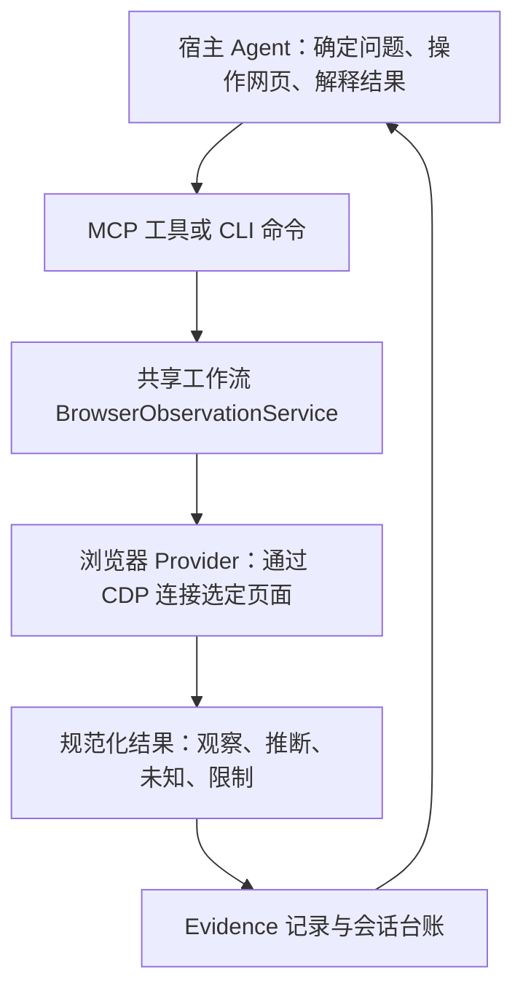

# rea 学习笔记｜M4.5 第一步

研究日期：2026-10-13。本文记录安装前的研究；学习笔记及接入取舍现已获用户确认。第二步的实际状态另见[安装与宜家试点验证记录](rea-installation.md)，下文“已做/未做”保留研究当时口径。

## 先说结论

rea 最值得借鉴的是：**先把网页上实际发生的事记清楚，再让每个判断能回到具体证据。** 它能帮助我们看到页面结构、加载的脚本、观察期间的请求和截图，但不会自动给出可信的整篇产品报告，也不能保证查出网站背后用了哪家大模型。

建议首版由宿主浏览器完成正常浏览，rea 负责被动采集；报告只提炼与产品决策有关的技术事实。优先借鉴它的证据结构、观察与推断分离、采集范围说明；暂不引入主动操作场景、脚本导出和原生程序逆向能力。

有两个接入前必须解决的实际问题：本机默认 Node 为 `v25.8.1`，不在 rea 声明的支持范围；本次阅读的 GitHub main 比 npm 发布版新，第二步必须按实际安装版本重新核对工具参数。[R2][R3]

## 1. 阅读范围与版本

| 项目 | 本次核对结果 |
| --- | --- |
| 上游项目 | [morluto/rea](https://github.com/morluto/rea)，Reverse Engineer Anything |
| 主要阅读版本 | GitHub main 固定提交 `3ae826ceba6f25b08bce50bcb51001209bc16b57`；下文源码链接固定到该提交 |
| 当日 npm 发布版 | `rea-agents@6.4.0`；registry 的 `gitHead` 为 `a56f7bb668ab23fec8d33f7af353ac7ed2fe1895` |
| 发布版交叉核对 | 阅读对应提交的网站观察文档，并对照核心 Provider、工作流和工具注册源码；主要被动工具已存在，细节与防护有差异 |
| Node 要求 | `^22.19.0 \|\| ^24.11.0 \|\| >=26.0.0`；建议后续选受支持的 Node 24 LTS，不沿用本机 Node 25 |
| 许可证 | MIT，版权为 `Copyright (c) 2026 morluto`；第三方依赖另有许可说明 [R19] |
| 已做 | 阅读 README、网站观察/安装/MCP 合同及相关专题文档；沿调用链阅读网页采集、脚本分析、证据模型和部分测试源码 |
| 未做 | 未安装依赖、未运行 rea 或其测试、未修改 MCP 配置、未用 rea 采集三款产品 |

main 的 `package.json` 也写着 6.4.0，不能由此认定内容等于 npm 6.4.0。registry 的 `gitHead` 用于定位对应源码，不等于已核验发布包字节一致；上游安装文档也明确区分 main 与 npm。[R2][R3]

## 2. 整体架构：工具拆小，流程复用，证据统一

rea 是供 Agent 使用的分析工具集合。宿主负责决定观察什么、何时操作页面、如何解释结果；rea 把外部观察转换成统一的 Evidence 记录。网站分析只是其中一个 Provider，并非整个项目的全部能力。[R1][R4]

| 层 | 源码位置与职责 |
| --- | --- |
| 启动与通信 | `scripts/rea.mjs` 分发 CLI/MCP；`src/main.ts` 管理 stdio MCP 入口、会话与 Provider [R4] |
| 工具合同 | `src/server/registerBrowserTools.ts` 注册细分工具、验证参数、调用工作流、写证据台账，再返回结果 [R5] |
| 共享工作流 | `src/application/BrowserObservationService.ts` 组织观察步骤；CLI 与 MCP 使用同一套应用逻辑 [R6] |
| 依赖装配与采集 | `src/composition/browserObservation.ts` 组装 `CdpBrowserProvider`；后者连接选定目标并管理自己建立的连接 [R7] |
| 领域模型 | `src/domain/` 定义观察结果、脚本分析、比较与 Evidence，减少通信细节对分析规则的影响 [R12][R14] |
| 证据交付 | `BrowserEvidence.ts` 封装来源与范围；`EvidenceLedger` 校验、保存、去重；MCP 返回正文与结构化结果，附证据 ID [R15][R16][R17] |

### 网页工具如何配合

以下为被动网站观察这条链上的工具，不是 rea 的全部工具。[R8]

| 工具 | 负责什么 | 本项目首版取舍 |
| --- | --- | --- |
| `list_browser_targets` | 找到当前浏览器可观察的页面，得到本次会话的 target ID | 使用，限定目标网站 |
| `inspect_web_page` | 采集结构、资源、脚本元数据和观察窗口内的网络等信息 | 核心能力，按需打开额外采集项 |
| `analyze_web_bundle` | 静态解析所选脚本，提取模块关系、接口/路由候选和指纹 | 只在回答具体问题时用；不解混淆，不拉 source map |
| `observe_web_session` | 在宿主或用户操作期间观察导航、重载、生命周期等事件 | 辅助确认步骤和页面变化；不是完整 AI 请求内容抓包器 |
| `capture_web_screenshot` | 捕获当前可见视口并生成内容哈希 | 按需用，优先复用宿主已有截图 |
| `compare_web_captures` | 比较两次采集；缺失或截断不能当成相同 | 后续有前后状态问题再用 |
| `compare_web_screenshots` | 本地 PNG 像素比较，不做 OCR | 首版不需要 |
| `discover_webmcp_tools` | 发现网页声明的 WebMCP 工具，不调用它们 | 首版不需要 |

**被动观察与主动场景必须分开理解。** `CdpBrowserProvider` 连接已经运行的 Chrome 系浏览器，通过本机回环地址上的 CDP 观察选定页面；不替用户启动、点击、导航，不执行 `Runtime.evaluate`，结束时只释放自己的连接。另一个 `capture_browser_scenario` 路径使用 Playwright，可启动或连接浏览器并执行声明式操作。两者的权限、生命周期不同；主动场景也没有独立的 origin allowlist 网络拦截层，不能套用被动观察的范围约束。本项目首版选前者。[R8][R18]

## 3. 分析网站时看什么，具体怎么拿到

### 页面结构：知道有什么，不默认收整页文字

`CdpPageCapture.ts` 调用 `DOMSnapshot.captureSnapshot`，其中 `computedStyles` 为空，不采集布局和绘制信息。规范化后的 DOM 主要保留节点类型、名称、文本长度和属性名，不默认保留正文或属性值。可访问性结构帮助识别控件角色；名字和描述需要显式开启 `include_accessibility_text`。[R9][R10]

这适合回答“页面由哪些控件组成”，不等于还原像素级界面。采集前后还会检查主 frame 与 origin；目标在期间发生不允许的变化时返回 `target_changed`，避免把两页拼成一份证据。[R9]

### 脚本与资源：静态读线索，不执行页面代码

资源来自 `Page.getResourceTree`，脚本信息来自 `Debugger.scriptParsed`。开启 `include_script_sources` 后才通过 `Debugger.getScriptSource` 取脚本文本；记录会关联脚本 URL、frame、哈希及 source-map 声明。[R9][R11]

`analyze_web_bundle` 用 Babel AST 解析所选脚本，不执行脚本。它可以识别 import/chunk 关系和接口、路由候选；字符串拼接、运行时配置或服务端行为仍可能无法确定。[R12]

厂商识别也需要看实现：当前内置指纹主要是 webpack、Vite、React、Vue、Next.js、Angular、Svelte。匹配脚本中的特征字符串后，结果进入 `inferences`，并带上脚本标识、文件哈希和检测规则。**它不是开箱即用的大模型、支付、埋点和客服厂商全量识别库。** 我们仍需将实测域名/脚本与厂商公开文档交叉核对；出现某 SDK 也不证明当前功能实际调用了它。[R13]

### 网络与交互：只覆盖连接后的观察窗口

采集器启用相关 CDP 域后监听请求、响应、加载结束及 WebSocket 等事件，记录方法、URL、状态、MIME、大小、资源类型和发起信息。默认观察窗口为 500 ms；网络和 console 的 `prior_activity_available` 固定为 `false`。因此，**没有采到某条请求，只说明本次记录中没有，不能说网站从未发过。** 对 AI 交互应先开始观察，再由宿主进行已授权的操作，并给足合理窗口。[R9][R11]

网页观察结果不保留认证头、Cookie 原文或任意响应正文。可选 JSON / WebSocket shape 只保留结构、类型、数量，不保留值；不能把这一能力写成“完整还原 AI 请求与回答”。[R8]

观察范围使用精确 origin，默认是选定页面当前 origin。第三方 CDN、分析或 AI 域名可能被过滤；要根据正常浏览实际发现的资源，把相关 origin 明确加入下一次观察范围。过滤、截断、连接前发生的活动，都必须作为限制写进结论。[R8]

对 M4.5 的 AI 调用判断，建议采用下面的口径。这些是**本项目拟采用的判定规则，不是三款产品的实测结果**：

| 看到的证据 | 可以写什么 | 仍不能确认什么 |
| --- | --- | --- |
| 浏览器直接请求经官方资料核对的厂商 API 域名 | 【观察】该交互存在浏览器到该域名的请求；结合用途证据再解释功能 | 不由域名推出具体模型、合同、成本或所有流量去向 |
| 浏览器请求网站自己的 `/api/chat` 一类路径 | 【观察】前端请求本站接口；【推断】可能由后端处理或转发 | 后端究竟调用谁、是否自建模型、如何路由 |
| 关联请求的响应 MIME 为 `text/event-stream` | 【观察】收到声明为 SSE 的响应；结合持续响应迹象判断流式方式 | 不由 SSE 推出模型厂商，也不把它等同于已经核对每个增量事件 |
| 页面逐字显示，或仅观察到 WebSocket/分块传输 | 记录可见呈现或传输现象 | 不直接认定大模型流式生成；可能是前端动画或其他通道 |
| 脚本里出现某厂商名称或 SDK 文件 | 【观察】加载了某文件/存在某字符串；用途解释另列【推断】 | SDK 是否启用、是否服务于当前步骤、实际付费量 |

### 截图：固定可见视口，保留文件身份

`CdpScreenshot.ts` 使用 `Page.captureScreenshot`，设置 PNG、`fromSurface: true`、`captureBeyondViewport: false`，并校验采集前后 frame 状态。产物带 SHA-256，便于对应同一张图；它不是自动长截图，也不做 OCR。[R8][R11]

## 4. “每个结论有证据”是怎样实现的

准确地说，rea 先让**工具结果可追溯**；最后每句自然语言结论是否准确引用证据，还要宿主负责。

### 统一记录，而不是只返回一段分析文字

`evidence.ts` 定义了这些关键字段：[R14]

| 字段 | 用途 |
| --- | --- |
| `evidence_id` | 基于语义内容生成的 `ev_…` 标识 |
| `provider`、`operation`、`parameters` | 谁观察、调用了什么工具、用什么参数和范围 |
| `raw_result`、`normalized_result` | 原始结果（允许为空）与规范化结果；不能假定一定附完整抓包 |
| `confidence` | `observed`、`derived`、`inferred`，区分观察、计算得到、推断 |
| `authority`、`environment` | 观察来源与执行环境；未获知部分明确保留未知 |
| `limitations`、`locations`、`evidence_links` | 限制、证据定位与其他证据的关联 |

源码把语义投影规范化后做 SHA-256；解析时重算 ID，内容改了却沿用旧 ID 会被拒绝。仅用于展示的 subject 路径不参与该身份计算，所以迁移文件位置不会让同一证据变成另一份。**哈希保证内容可核验，不保证观察真实或结论正确，也不是第三方签名。**[R14]

### 台账、结构化交付与未知项

工具成功后写入 `EvidenceLedger`：校验记录，保存不可变快照，重复内容幂等去重，冲突内容拒绝写入。MCP 通过 text 与 `structuredContent` 交付结果及证据标识，会话证据可导出为 bundle；超过传输预算有明确错误与证据引用，不靠静默截断伪装完整结果。[R5][R16][R17]

脚本分析内部还区分 `observations`、`inferences`、`unknowns`、`completeness` 和 `limitations`。网页 Evidence 外层虽然标为 `observed`，里面的厂商指纹仍是 `inferences`，不能因为外层标签就把推断升级成事实。[R12][R13][R15]

### 本项目要补上最后一段：证据到报告句子的映射

技术透视每条结论应对应一条简明记录：**页面与动作 → 时间/窗口/范围 → 域名或脚本路径 → 方法、状态、MIME 等相关事实 → 证据位置 → 【观察】/【推断】 → 未确认项。** 再单独写对产品的影响，并说明影响是待验证判断，不能由前端线索直接推出成本降低或性能提升。

公开报告可用 `T1` 等简短编号连接到脱敏证据。脱敏副本发生了内容变化，就不能继续冒充原始 Evidence 或声称通过原始 `evidence_id` 校验；应明确标为“脱敏摘要”，只保留安全的定位关系，必要时为公开副本另算文件哈希。

## 5. 借鉴与不借鉴

| 取舍 | 原因与本项目做法 |
| --- | --- |
| 借：宿主操作 + 被动观察的职责划分 | 保持 Skill 轻量，由现有浏览器走产品路径，rea 提供技术证据 |
| 借：按任务拆工具、共用工作流 | 先确定产品问题，再选必要工具；不为了展示能力把所有工具跑一遍 |
| 借：观察、推断、未知、采集限制分开 | 技术结论与 M4 既有来源纪律一致，避免把“没看到”写成“没有” |
| 借：证据标识、参数、时间和具体定位 | 一条结论能回到某次采集的具体域名、脚本或截图 |
| 借：静态脚本线索与真实网络记录交叉核对 | 脚本存在不代表实际调用；请求目标也不自动暴露服务端实现 |
| 暂不借：Playwright 主动场景 Provider | 宿主已经能操作页面，首版无需另一套浏览器控制与生命周期 |
| 暂不借：脚本批量导出、source-map 拉取、模块追踪、精确覆盖率 | 对一页产品报告过重；不为凑结论追隐藏资源。覆盖率采集还可能改变 JIT/时序 [R20] |
| 不借：二进制、原生进程、反编译和其他原生逆向栈 | 超出公开网页拆解范围，违反本项目边界；不安装 Hopper/Ghidra/IDA 等相关依赖 |
| 不直接收录：完整 Evidence、脚本和 URL 原文 | rea 会保留 URL 查询参数/fragment；可选脚本文本、可访问性文本、console primitive 也可能带敏感内容，不能把上游的“安全元数据”理解为已适合公开提交 [R8] |

存档以最少信息为原则：公开保留域名、去敏脚本路径、必要状态/MIME、截图与限制；去掉查询参数、fragment、会话标识和个人数据。遇疑似泄露的密钥、令牌或内部接口，不使用、不记录原文，只写“发现疑似敏感信息暴露”并打码。默认关闭 console 文本、storage 内容相关选项、响应 shape 和 source-map 拉取，确有公开分析需要再限定采集范围。

本轮只学习方法和引用源码，没有复制 rea 的实现。第二步 README 应增加致谢；如后续借用代码，保留 morluto 的版权与 MIT 声明，并按涉及内容核对第三方许可。学习用途不改变许可证义务。[R19]

## 6. 第二步建议方案（尚未执行）

1. **环境和安装计划。** 确认本机是否已有受支持的 Node；优先使用 Node 24 LTS（至少 24.11）。拟固定 `rea-agents@6.4.0`，核对发布包和实际工具 schema，不直接追随 main。安装方式、位置、宿主配置变更先列成具体计划，按 TASKS 要求等用户批准再执行。[R2][R3]
2. **只接需要的能力。** 安装后先查看 `setup --client codex --skill=false --dry-run` 计划；`--skill=false` 用于避免附带完整逆向工作流 Skill，不能把它解释成只注册网页工具。是否能限制工具暴露需以实际包为准；调用范围只限网页能力。不安装原生逆向工具。[R3]
3. **确认浏览器连接。** rea 需要显式可用的本机 CDP 端点，不能假定当前宿主浏览器已经开放。若需新建浏览器配置，使用独立、未登录的配置并仅监听回环地址；现有浏览器与宿主能否共同操作该实例，在接入时验证。[R8]
4. **先做一个最小闭环。** 选择宜家公开路径中的一个页面，选定 target → 配置精确 origin → 先开始观察 → 宿主正常加载/操作 → 收集技术事实与截图 → 生成脱敏证据条目。确认能支撑报告，再扩展到秘塔和少数派；需要新增有额度/费用影响的 AI 提问时另按已授权范围执行。
5. **再补交付。** 更新 teardown 技术透视步骤和模板，三例各补第三方服务、AI 调用方式、观察/推断与一句产品影响。遇登录核心阻塞立即停下说明；后端模型无法核实就写未知，不补猜测厂商名。沿用“30 秒速读”，保持其不带证据编号和来源标记。

第二步的成功标准是“技术结论可核对、限制清楚、对产品判断有用”，不是三份报告必须认出某个模型或凑齐全部服务类别。完成后再按 M4.5 整体清单验收。

## 7. 本轮核验与阶段状态

- 已把 README/文档中的网页能力与实际工具注册、Provider、采集实现、Evidence 和台账交叉核对，引用固定到阅读提交。
- 交付检查：39 个固定版本源码/文档链接的文件与行号存在，21 组来源编号完整；仓库文本常见密钥模式扫描无匹配，文档差异检查通过。
- 已阅读部分证据 ID、完整性和浏览器 MCP 边界测试源码，包括路径迁移不改 ID、内容篡改拒绝、连接窗口/过滤/截断标记；**没有运行这些测试**，不把上游测试存在当成本机通过。[R21]
- 学习笔记覆盖 TASKS 第一步要求的四项：架构、采集方式、证据实现、借鉴取舍。
- 三份示例目前只增加用户要求的“30 秒速读”；技术透视尚未添加。rea 安装、运行核验和 README 接入致谢属于第二步。
- 依 TASKS 的“交笔记，停下来等我确认再进入第二步”，本轮到此停止；未推送或发布。

## 来源索引

以下除 npm registry 外，均为固定 GitHub 提交链接；不是对 main 的浮动引用。引用的是代码和文档说明，不代表本机已经验证运行效果。

- [R1] [README](https://github.com/morluto/rea/blob/3ae826ceba6f25b08bce50bcb51001209bc16b57/README.md)、[架构图](https://github.com/morluto/rea/blob/3ae826ceba6f25b08bce50bcb51001209bc16b57/docs/architecture.mermaid)。
- [R2] [npm latest 元数据（随发布变化）](https://registry.npmjs.org/rea-agents/latest)、[6.4.0 对应源码 package.json](https://github.com/morluto/rea/blob/a56f7bb668ab23fec8d33f7af353ac7ed2fe1895/package.json)、[发布版网站观察文档](https://github.com/morluto/rea/blob/a56f7bb668ab23fec8d33f7af353ac7ed2fe1895/docs/browser-observation.md)。
- [R3] [安装与 setup 选项](https://github.com/morluto/rea/blob/3ae826ceba6f25b08bce50bcb51001209bc16b57/docs/installation.md#L71)、[main 与 npm 差异](https://github.com/morluto/rea/blob/3ae826ceba6f25b08bce50bcb51001209bc16b57/docs/installation.md#L196)、[Node 支持范围](https://github.com/morluto/rea/blob/3ae826ceba6f25b08bce50bcb51001209bc16b57/docs/installation.md#L844)。
- [R4] [命令分发](https://github.com/morluto/rea/blob/3ae826ceba6f25b08bce50bcb51001209bc16b57/scripts/rea.mjs)、[MCP 主入口](https://github.com/morluto/rea/blob/3ae826ceba6f25b08bce50bcb51001209bc16b57/src/main.ts)。
- [R5] [网页工具注册与台账交付](https://github.com/morluto/rea/blob/3ae826ceba6f25b08bce50bcb51001209bc16b57/src/server/registerBrowserTools.ts)。
- [R6] [BrowserObservationService](https://github.com/morluto/rea/blob/3ae826ceba6f25b08bce50bcb51001209bc16b57/src/application/BrowserObservationService.ts)。
- [R7] [装配](https://github.com/morluto/rea/blob/3ae826ceba6f25b08bce50bcb51001209bc16b57/src/composition/browserObservation.ts)、[CdpBrowserProvider](https://github.com/morluto/rea/blob/3ae826ceba6f25b08bce50bcb51001209bc16b57/src/browser/CdpBrowserProvider.ts)。
- [R8] [网站观察文档：工具、Provider、边界、敏感字段与完整性](https://github.com/morluto/rea/blob/3ae826ceba6f25b08bce50bcb51001209bc16b57/docs/browser-observation.md)。
- [R9] [页面采集流程](https://github.com/morluto/rea/blob/3ae826ceba6f25b08bce50bcb51001209bc16b57/src/browser/CdpPageCapture.ts#L234)、[采集参数默认值](https://github.com/morluto/rea/blob/3ae826ceba6f25b08bce50bcb51001209bc16b57/src/domain/browserObservation.ts#L97)。
- [R10] [DOM / 可访问性 / 资源规范化](https://github.com/morluto/rea/blob/3ae826ceba6f25b08bce50bcb51001209bc16b57/src/browser/CdpCaptureDocuments.ts)。
- [R11] [脚本采集](https://github.com/morluto/rea/blob/3ae826ceba6f25b08bce50bcb51001209bc16b57/src/browser/CdpPageCaptureScripts.ts)、[事件采集](https://github.com/morluto/rea/blob/3ae826ceba6f25b08bce50bcb51001209bc16b57/src/browser/CdpCaptureEvents.ts)、[截图](https://github.com/morluto/rea/blob/3ae826ceba6f25b08bce50bcb51001209bc16b57/src/browser/CdpScreenshot.ts#L78)。
- [R12] [脚本静态分析](https://github.com/morluto/rea/blob/3ae826ceba6f25b08bce50bcb51001209bc16b57/src/domain/webBundleAnalyzerInspection.ts)、[结果、推断与完整性](https://github.com/morluto/rea/blob/3ae826ceba6f25b08bce50bcb51001209bc16b57/src/domain/webBundleAnalyzerResult.ts)。
- [R13] [指纹推断及 basis](https://github.com/morluto/rea/blob/3ae826ceba6f25b08bce50bcb51001209bc16b57/src/domain/webBundleAnalyzerInspection.ts#L315)、[内置指纹清单](https://github.com/morluto/rea/blob/3ae826ceba6f25b08bce50bcb51001209bc16b57/src/domain/webBundleAnalyzerInspection.ts#L405)。
- [R14] [Evidence 字段](https://github.com/morluto/rea/blob/3ae826ceba6f25b08bce50bcb51001209bc16b57/src/domain/evidence.ts#L112)、[语义投影、ID 与校验](https://github.com/morluto/rea/blob/3ae826ceba6f25b08bce50bcb51001209bc16b57/src/domain/evidence.ts#L237)。
- [R15] [网页 Evidence 封装](https://github.com/morluto/rea/blob/3ae826ceba6f25b08bce50bcb51001209bc16b57/src/application/BrowserEvidence.ts#L78)。
- [R16] [EvidenceLedger 校验与去重](https://github.com/morluto/rea/blob/3ae826ceba6f25b08bce50bcb51001209bc16b57/src/application/investigation/EvidenceLedger.ts#L44)。
- [R17] [MCP 合同](https://github.com/morluto/rea/blob/3ae826ceba6f25b08bce50bcb51001209bc16b57/docs/mcp-contracts.md)、[toolResult](https://github.com/morluto/rea/blob/3ae826ceba6f25b08bce50bcb51001209bc16b57/src/server/toolResult.ts)。
- [R18] [主动浏览器场景](https://github.com/morluto/rea/blob/3ae826ceba6f25b08bce50bcb51001209bc16b57/docs/browser-scenario-contract.md)。
- [R19] [MIT LICENSE](https://github.com/morluto/rea/blob/3ae826ceba6f25b08bce50bcb51001209bc16b57/LICENSE)、[第三方许可说明](https://github.com/morluto/rea/blob/3ae826ceba6f25b08bce50bcb51001209bc16b57/THIRD_PARTY_NOTICES.md)。
- [R20] [脚本导出](https://github.com/morluto/rea/blob/3ae826ceba6f25b08bce50bcb51001209bc16b57/docs/website-script-export.md)、[模块追踪](https://github.com/morluto/rea/blob/3ae826ceba6f25b08bce50bcb51001209bc16b57/docs/website-module-trace.md)、[运行时覆盖率](https://github.com/morluto/rea/blob/3ae826ceba6f25b08bce50bcb51001209bc16b57/docs/web-runtime.md#L14)。
- [R21] [Evidence 测试](https://github.com/morluto/rea/blob/3ae826ceba6f25b08bce50bcb51001209bc16b57/src/domain/evidence.test.ts#L317)、[采集完整性测试](https://github.com/morluto/rea/blob/3ae826ceba6f25b08bce50bcb51001209bc16b57/src/browser/CdpCaptureCompleteness.test.ts)、[浏览器 MCP 边界测试](https://github.com/morluto/rea/blob/3ae826ceba6f25b08bce50bcb51001209bc16b57/tests/boundary/mcp/browserMcp.test.ts)。
