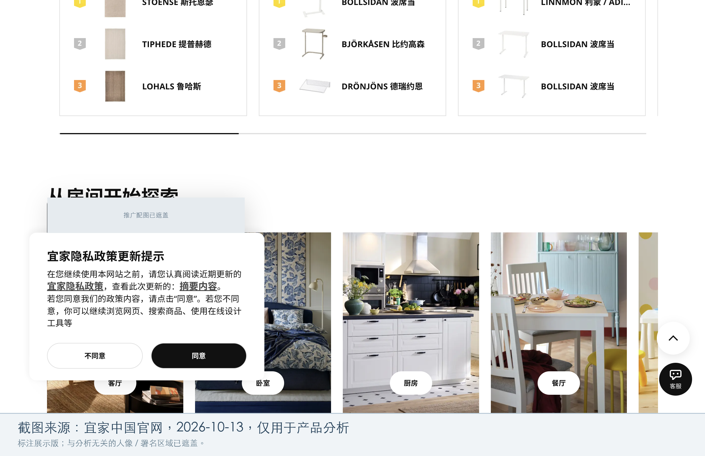

# 宜家中国首页｜技术透视试点

## 30 秒速读

1. **做得最好的一点：** 按客厅、卧室、厨房等房间提供逛店入口，用户可以从自己想布置的空间开始找。
2. **最大的一个问题：** 隐私提示和设计服务推广叠在一起，滚动后仍遮住部分房间入口。
3. **如果我来做，第一件事改什么：** 先错开提示与推广的出现时机，保留清楚的隐私选择，让用户能看清并进入房间内容。

采集日期：2026-10-13，时区 UTC+8。范围：[宜家中国首页](https://www.ikea.cn/cn/zh/)，全新未登录浏览器，只看首页及一次向下滚动。本次是 M4.5 第二步的单页试点，补充原 M4 产品分析；不是全站技术审计。来源编号见[证据附录](sources.md)。

## 页面上看到了什么

【观察】首页有商品搜索、房间、设计和服务等入口，右下角有“客服”；向下滚动可见“从房间开始探索”及客厅、卧室、厨房、餐厅卡片。[S2][S3]

【观察】本次路径为：打开首页 → 点击 Cookie 提示的“我接受” → 出现隐私政策更新提示 → 不选择同意或不同意，向下滚动。隐私提示与设计推广在首屏、滚动后的截图中均有重叠，部分房间内容被遮挡。[S1][S2][S3]

【推断】按房间组织内容可能更贴近布置空间的任务；叠加浮层则可能打断这个入口的发现。建议先将设计推广延后到用户完成或关闭隐私选择之后，再用小范围实验比较房间入口点击率、完成隐私选择所需时间；本次没有测量转化损失，也没有验证改版效果。[S2][S3]

## 技术透视

| 项目 | 直接证据 | 判断与边界 |
| --- | --- | --- |
| 埋点分析 | 【观察】资源清单含 `assets.giocdn.com/2.1/gio.js`；GrowingIO 官方集成示例给出同一地址。[E1][D1] | 【观察】可确认页面加载了 GrowingIO SDK。【推断】它可能用于行为分析；本窗口未采到其上报请求，不能确定实际采集了哪些事件或数据。 |
| 行为验证 | 【观察】加载 `static.geetest.com/static/tools/gt.js`；极验文档将其产品定位为交互安全与行为验证服务。[E1][D2] | 【推断】是验证/风控相关接入线索；本次没有触发验证码，不能确定哪些流程启用或具体产品代际。 |
| 其他第三方组件 | 【观察】加载 `g.alicdn.com/AWSC/AWSC/awsc.js` 和 `AWSC/et/1.83.41/et_f.js`。[E1] | 【观察】能确认这些文件来自该域名；本次未核实具体服务、配置和启用流程。 |
| 图片分发 | 【观察】滚动观察窗口内，`file.app.ikea.cn` 有 5 条图片请求，全部 `200`，响应类型为 `image/webp`。[E1] | 【推断】与滚动时按需取图的行为一致；没有验证因果关系、全页流量节省或 CDN 供应商。 |
| 客服 / 大模型 | 【观察】截图有“客服”入口，资源含 `Chatbot.B7aw_qHv.css`。[S2][E1] | 【观察】仅确认入口和样式资源。【推断】文件名不足以证明使用生成式 AI；模型厂商、前端直连或后端转发、是否流式输出均未确认。 |
| 支付 | 【观察】本次只观察首页，未进入结算或付款流程。[E1][S1–S3] | 未形成支付服务商结论；不能把本次没有证据写成没有接入。 |
| 前端实现线索 | 【观察】同源脚本 `ikeacn-web-next/CiLYAH80.js` 被 rea 的 `vite-runtime`、`vue-runtime` 规则命中。[E2] | 【推断】存在 Vite / Vue 运行时特征，rea 置信度均为 medium。目录名中的 `web-next` 不证明使用 Next.js。 |

**这些技术选择对产品意味着什么：**【推断】图片展示与行为分析已各有实现线索，后续可以围绕“房间入口是否被看到、是否被点击”设计体验实验；实际事件口径和实验可行性仍需产品团队核实，不能仅凭 SDK 存在就认定已有监测能力。[E1][D1][S3]

## 一次滚动，实际多了什么证据

【观察】18:18:16.295–18:18:23.389 的约 7 秒窗口内，宿主于 18:18:17.797 向下滚动 1800 CSS 像素。采集结果包含 26 个脚本、79 个资源和下列 5 条请求；脚本和资源清单也可包含此前已加载的内容，不能都算作这 7 秒内新增下载。[E1]

| 请求编号 | 方法 / 状态 | 响应类型 | CDP 记录的 encoded_data_length（字节） |
| --- | --- | --- | ---: |
| N1 | GET / 200 | image/webp | 61,518 |
| N2 | GET / 200 | image/webp | 14,775 |
| N3 | GET / 200 | image/webp | 31,362 |
| N4 | GET / 200 | image/webp | 23,746 |
| N5 | GET / 200 | image/webp | 48,360 |

【观察】五条来自 `https://file.app.ikea.cn/cms/u/20260210/[id].jpg`，公开摘要把各自的文件标识替换为 `[id]`；N1–N5 是五条不同记录。URL 后缀为 `.jpg`，实际响应 MIME 为 WebP。[E1]

## 结论能走到哪里

【观察】采集结果标记为 `policy_filtered`，只保留允许范围；连接前的网络活动不可追溯。另一次同源静态分析成功解析选定的 21 个脚本；它不是 21 次网络请求，也不是整站覆盖。[E1][E2]

【观察】静态分析还提取到两个 `event-tracking-service` 路径候选，详见附录；本次没有主动请求这些路径，也没有证据证明它们在观察窗口内被调用。[E2]

本例验证了“页面现象 → 请求/脚本 → 有边界的产品判断”这条交付链。安装、MCP 验证、浏览器清理以及一次窗口误读的情况见[执行与验证记录](../../rea-installation.md)。秘塔、少数派及通用 Skill/模板的技术透视扩展，等本例效果确认后再做。
